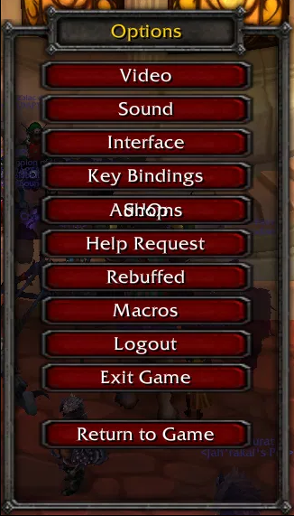

# Addon Control Panel – 3.3.5a fix

> In-game addon manager for World of Warcraft **3.3.5a**, with a layout fix.

**This is not my addon.** Addon Control Panel (ACP) by **sylvanaar**, based on rMCP by **Rophy**, originally MCP by **Saien** – original project: https://www.curseforge.com/wow/addons/acp

## What's changed
- `ACP.xml`: layout fix for the Whitemane-Frostmourne Rebuffed 3.3.5a client

## Screenshot

## Installation
Copy the `ACP` folder into `World of Warcraft/Interface/AddOns/`, then `/reload`.

## License
The original addon ships without a license file; all rights remain with the original authors. If you are an author and want this removed, please open an issue and it will be taken down.
